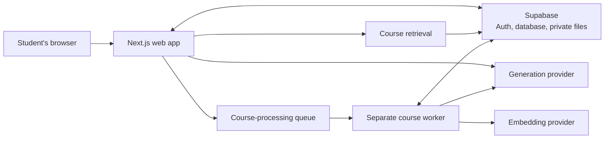

# Miva Buddy

Miva Buddy is a learning companion for Computer Science and Software Engineering students. I built it as an independent student project for Miva Open University students. It is not an official Miva University product.

I started building it around a familiar moment: you finish a lecture, but the idea still does not quite make sense. Your notes are in one place, a video in another, an AI chat somewhere else, and practice problems on a separate site. It can be hard to know what to study next, or how to get help without giving away the answer.

Miva Buddy brings course learning and DSA practice together, and makes room for career preparation without pretending to know more than its sources do.

**Hackathon demo:** [miva-buddy.onrender.com](https://miva-buddy.onrender.com). The hosted app is available, but production reliability is still being worked on; see [Current status and limitations](#current-status-and-limitations).

## What it is like to use

### When you’re studying a course

Create a course, then add lecture notes or a PDF. Miva Buddy processes the material, finds concepts to explore, and keeps page references so you can see where a grounded answer came from.

You can also ask a general question in Learn. That conversation has no course material attached, so its answer is a general explanation—not a course-grounded one. Conversations are saved so you can come back to them. If your browser supports speech recognition, you can dictate into the Learn composer, review and edit the text, then send it yourself.

### When you’re practising DSA

Choose from 14 patterns and 107 curated problems. Open a problem in Miva Buddy, follow its link to the original LeetCode problem, and bring your own attempt or question back for coaching.

- **Hands Off** gives observations and reflective questions.
- **Coach** offers ideas and feedback, but not a complete answer.
- **Tutor** can walk through steps. It gives a complete answer only when you explicitly ask.

Miva Buddy does not see your LeetCode editor, submissions, or results. Completion is your own check-in; opening a problem does not mark it complete. Saved sessions and recent activity help you continue where you left off in the same browser.

### When you’re preparing for an interview

Ask about a company, role, or interview stage in the general Learn conversation. Miva Buddy can help with role-relevant topics, practice ideas, behavioral prompts, and a study plan based on what you told it.

It also offers external searches for Hacker News and LeetCode Discuss. These links open searches for you; Miva Buddy does not fetch or verify candidate accounts. The preparation is general guidance, not a description of that company’s interview process.

### When you’re connecting class to career preparation

Grounded Learn may show a few related job listings when the course material supports a concrete skill and an eligible metadata source is available. The cards show listing details and links, not verified employer requirements. Miva Buddy does not inspect job descriptions to prove a skill match, and the lesson still works when listings are unavailable.

## How the web app works

The browser talks to the Next.js app. The app handles student requests, saved data, course retrieval, and calls to the configured AI provider. Longer course processing runs separately in a worker, rather than inside the web request.



See [ARCHITECTURE.md](ARCHITECTURE.md) for the system boundaries and implementation details.

## Getting started

### You’ll need

- Node.js 20 or newer and npm.
- A Supabase development project (hosted or local) configured for Google sign-in.
- Docker Desktop and the Supabase CLI if you want an isolated local Supabase stack.
- PostgreSQL access for the background course-processing worker.

Miva Buddy is not an offline-only app: Supabase provides authentication and saved data. The app's intended sign-in flow is Google OAuth through Supabase Auth; it does not rely on anonymous sign-in.

### Install and configure

#### 1. Install dependencies and configure the web app

Install the locked dependencies:

```sh
npm ci
```

Create an ignored `.env.local` file in the repository root. The web app needs:

```dotenv
NEXT_PUBLIC_SUPABASE_URL=<your-development-project-url>
NEXT_PUBLIC_SUPABASE_PUBLISHABLE_KEY=<your-development-publishable-key>
APP_BASE_URL=http://localhost:3000
DATABASE_URL=<local-database-url>
```

`APP_BASE_URL` is optional in local development; it is shown here to make the callback origin explicit. `DATABASE_URL` is needed for the worker and database-backed operations. Never commit `.env.local`, database URLs, or provider credentials.

#### 2. Start local Supabase and prepare its database and Storage

For an isolated local stack, start Docker Desktop and run:

```sh
npx supabase start
npm run db:migrate:local
```

- **Migration safety:** `npm run db:migrate:local` verifies the local Supabase/Docker identity and loopback database endpoint before invoking Drizzle. Do not replace it with an unguarded migration command.
- **Private Storage:** Before uploading, confirm the private `course-materials` bucket exists in local Storage Studio. If it does not, create it through the local Storage UI; do not edit Storage's internal tables.
- **Hosted databases:** Follow the reviewed procedure in the [Supabase setup guide](docs/engineering/milestone-1-supabase-setup.md). Never point the local-only guarded command at a hosted database.

#### 3. Configure Google sign-in if testing OAuth locally

The local Supabase config reads `SUPABASE_AUTH_EXTERNAL_GOOGLE_CLIENT_ID` and `SUPABASE_AUTH_EXTERNAL_GOOGLE_CLIENT_SECRET` from the Supabase CLI environment. These are server-side OAuth credentials, not Next.js browser variables. Follow the [Google Auth setup guide](docs/engineering/google-auth-setup.md); never put the client secret in the repository or a `NEXT_PUBLIC_` variable.

#### 4. Choose AI providers

Ordinary local development can use deterministic fake responses. To use a real generation provider, set `AI_PROVIDER`:

- Fake: `AI_PROVIDER=fake` (development and tests; not accepted for production).
- Gemini: `AI_PROVIDER=gemini` and a server-only `GEMINI_API_KEY`.
- Ollama: `AI_PROVIDER=ollama`, plus a reachable `OLLAMA_BASE_URL` and `OLLAMA_MODEL` (default `llama3.1`).
- Groq: `AI_PROVIDER=groq` and a server-only `GROQ_API_KEY`.

For embeddings, configure `EMBEDDING_PROVIDER` separately. Choose `fake` for tests, `ollama` with `OLLAMA_BASE_URL` and `OLLAMA_EMBEDDING_MODEL` (default `nomic-embed-text`) for local embeddings, or `gemini` with `GEMINI_API_KEY`. Do not compare stored vectors across different embedding model spaces; existing materials may need reprocessing after a provider/model change.

#### 5. Run the web app and worker

The web app and course-processing worker are separate processes during normal local development. Set server-only `DATABASE_URL` for database-backed operations, then run these in separate terminals:

Terminal 1 — web app:

```sh
npm run dev
```

Terminal 2 — course-processing worker:

```sh
npm run worker:dev
```

Open [http://localhost:3000](http://localhost:3000). First-time Google sign-in takes you to onboarding.

Without the worker, uploaded materials can remain queued and will not finish processing. The guarded `npm run dev:local-pdf-gemini` command can start the local web app and worker together after checking the local stack and queue.

**Safety note:** `npm run dev:local-pdf-gemini` makes real Gemini API calls and does not inspect or restrict uploaded content. Use synthetic material unless your provider account's current data-use terms allow real student content. Confirm billing, quotas, and terms first. See the [M3 setup record](docs/engineering/milestone-3-setup.md), [Gemini usage protections](docs/engineering/gemini-usage-protections.md), and [provider decision](docs/engineering/ai-provider-decision.md).

For the deployed Render demo's build/start commands and environment variables, see the [deployment guide](docs/engineering/deployment-readiness.md). Do not use a development server as a public server.

The `REMOTEOK_METADATA_PILOT=true` and `HIMALAYAS_METADATA_ENABLED=true` flags are optional. They are not needed to run Miva Buddy. Remote OK remains development-only, and neither job source verifies requirements from descriptions.

## Built with

- Next.js App Router, React, TypeScript, and CSS.
- Supabase Auth with Google OAuth, PostgreSQL, and private file storage.
- pg-boss for the course-processing queue.
- PostgreSQL full-text search and `pgvector` for course retrieval.
- Replaceable generation and embedding interfaces, with Gemini, Groq, and Ollama generation adapters and Gemini, Ollama, and deterministic fake embedding adapters.
- Zod for validation, Vitest for unit tests, and Playwright for browser tests.

## Repository map

```text
src/app/          Pages, server actions, and API routes
src/components/   Learn, Practice, course, and shared UI
src/contracts/    Validated request and response shapes
src/server/       Retrieval, AI, evidence, persistence, and worker logic
src/worker.ts     Separate course-processing worker
drizzle/          Database migrations
docs/             Product, architecture, engineering, and research docs
tests/            Unit, integration, and browser tests
```

## Development checks

```sh
npm run lint
npm run typecheck
npm test
npm run build
npm run test:e2e
npm run check:secrets
```

The default browser suite runs locally. Some legacy hosted Supabase tests create anonymous test identities and synthetic records; they are not Google-auth coverage and should only be run with an approved test-data plan. Local checks are not the same as hosted release acceptance.

The latest local code verification before this README update passed 535 tests (8 skipped), TypeScript, ESLint, and the production build including the worker bundle. These checks do not establish that the reported production authentication and flashcard issues are resolved.

Optional checks include `npm run test:embeddings:ollama` for a local synthetic embedding check and `npm run test:ai-evals` for synthetic prompts sent to the configured hosted AI provider. The dedicated local PDF/Gemini workflow is `npm run dev:local-pdf-gemini`; it requires a running local Supabase stack and a configured Gemini key, and makes provider requests. `npm run check:hosted-config` reports configuration status without printing values.

## Current status and limitations

- Miva Buddy is deployed at [miva-buddy.onrender.com](https://miva-buddy.onrender.com), but production is **not yet stable**. Recent reports include repeated authentication-verification failures and Home/Learn errors, plus intermittent flashcard-generation failures. The latest local authentication fix is not deployed; local tests do not confirm these production issues are resolved.
- Hosted migrations 0000–0013 and the three separately managed private `course-materials` Storage policies have been verified. Render runs the web app and PDF worker together; free-tier sleep and resource limits can delay processing. A complete production smoke test is still pending. See the [deployment guide](docs/engineering/deployment-readiness.md) for operational details.
- Gemini and upload safeguards are implemented, but provider-account billing/quota controls and end-to-end production behavior still require review. Job listings are related metadata, not verified skill requirements; see the [project status](docs/plans/project-status.md) for remaining scope and limitations.

## How I Used OpenAI Codex

I used Codex as a development assistant while I stayed responsible for the product decisions, scope, and review. It helped me break features into smaller tasks, map existing code before changing it, draft and refine implementation, investigate bugs, compare possible fixes, and write and run focused tests. I reviewed diffs and verification results before deciding what to keep or release.

The repository's root [`AGENTS.md`](AGENTS.md) records project boundaries, safety rules, and verified commands. Two project-local skills make repeatable work easier to follow: [`supabase-migration-validation`](.agents/skills/supabase-migration-validation/SKILL.md) for migration/schema validation and [`gemini-usage-protections`](.agents/skills/gemini-usage-protections/SKILL.md) for Gemini quotas, reservations, and safe diagnostics. They complement rather than replace the project instructions.

### Development inspiration

- [Harness engineering: leveraging Codex in an agent-first world](https://openai.com/index/harness-engineering/) — its focus on repository-local instructions, legible project knowledge, and enforceable feedback loops influenced how I keep development guidance and repeatable checks in the project.
- [How OpenAI uses Codex](https://openai.com/business/guides-and-resources/how-openai-uses-codex/) — its examples of codebase understanding, scoped tasks, iterative testing, and review informed how I used Codex to support—not replace—my own implementation and decisions.

## Demo

**Demo video:** _Coming soon._

## Further reading

- [Architecture](ARCHITECTURE.md)
- [Current project status](docs/plans/project-status.md)
- [Local and production setup](docs/engineering/deployment-readiness.md)
- [Product and student workflows](docs/product/product-specification.md)
