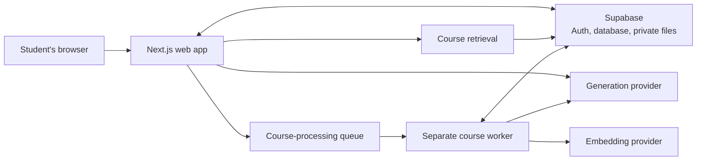
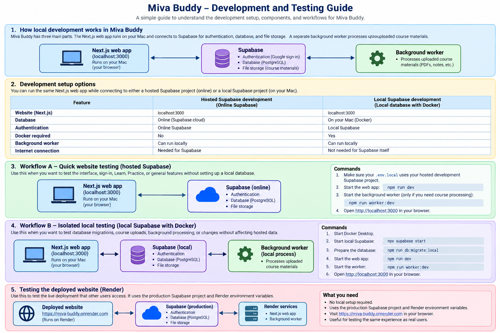
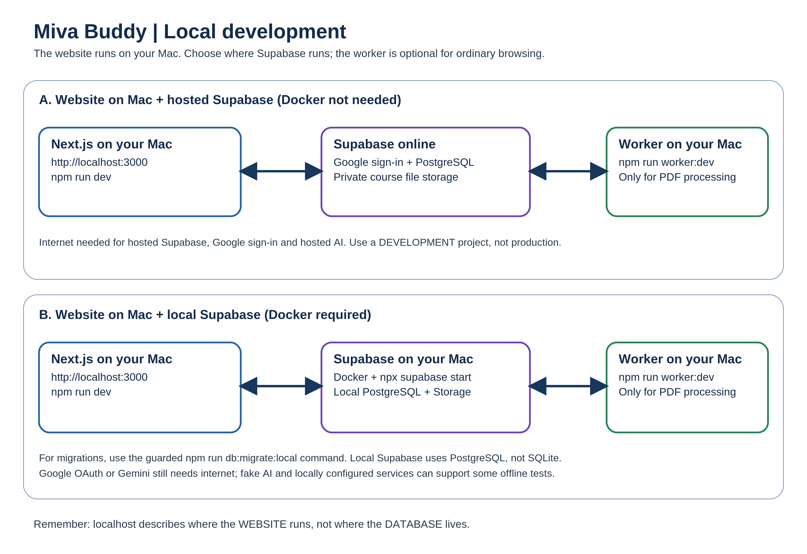
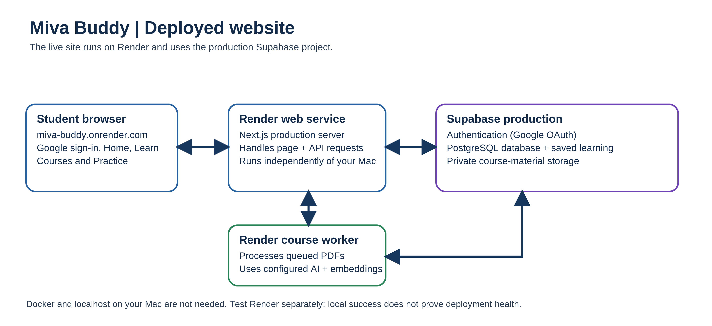

# Miva Buddy

Miva Buddy is a learning companion for Computer Science and Software Engineering students. I built it as an independent student project for Miva Open University students. It is not an official Miva University product.

I started building it around a familiar moment: you finish a lecture, but the idea still does not quite make sense. Your notes are in one place, a video in another, an AI chat somewhere else, and practice problems on a separate site. It can be hard to know what to study next, or how to get help without giving away the answer.

Miva Buddy brings course learning and DSA practice together, and makes room for career preparation without pretending to know more than its sources do.

**Hackathon demo:** [miva-buddy.onrender.com](https://miva-buddy.onrender.com).

**Demo video:** [Miva Buddy (Your AI-Powered learning companion)](https://youtu.be/jdwpqgrXO_0)


## What it is like to use

### When you’re studying a course

Create a course, then add lecture notes or a PDF. Miva Buddy processes the material, finds concepts to explore, and keeps page references so you can see where a grounded answer came from.

You can also ask a general question in Learn. That conversation has no course material attached, so its answer is a general explanation—not a course-grounded one. Conversations are saved so you can come back to them. If your browser supports speech recognition, you can dictate into the Learn composer, review and edit the text, then send it yourself.

### When you’re practising DSA

Choose from 14 patterns and 107 curated problems. Open a problem in Miva Buddy, follow its link to the original LeetCode problem, and bring your own attempt or question back for coaching.

- **Hands Off** gives observations and reflective questions.
- **Coach** offers ideas and feedback, but not a complete answer.
- **Tutor** can walk through steps. It gives a complete answer only when you explicitly ask.

Miva Buddy does not see your LeetCode editor, submissions, or results. Completion is your own check-in; opening a problem does not mark it complete. Saved sessions and recent activity help you continue where you left off in the same browser.

### When you’re preparing for an interview

Ask about a company, role, or interview stage in the general Learn conversation. Miva Buddy can help with role-relevant topics, practice ideas, behavioral prompts, and a study plan based on what you told it.

It also offers external searches for Hacker News and LeetCode Discuss. These links open searches for you; Miva Buddy does not fetch or verify candidate accounts. The preparation is general guidance, not a description of that company’s interview process.

### When you’re connecting class to career preparation

Grounded Learn may show a few related job listings when the course material supports a concrete skill and an eligible metadata source is available. The cards show listing details and links, not verified employer requirements. Miva Buddy does not inspect job descriptions to prove a skill match, and the lesson still works when listings are unavailable.

## How the web app works

The browser talks to the Next.js app. The app handles student requests, saved data, course retrieval, and calls to the configured AI provider. Longer course processing runs separately in a worker, rather than inside the web request.



See [ARCHITECTURE.md](ARCHITECTURE.md) for the system boundaries and implementation details.

## Getting started

[](docs/images/miva_buddy_development_and_testing_guide.png)

`http://localhost:3000` is the website running on your computer; it does not mean the database is local. The app can use either a dedicated hosted development Supabase project or an isolated local Supabase stack.

### Which workflow should I use?

- **Workflow A** is the quickest way to work on the website without Docker. It requires a dedicated hosted development Supabase project; do not use the production project for local testing.
- **Workflow B** is for isolated database, Storage, and course-processing work. It runs Supabase locally in Docker.
- **Workflow C** is the deployed Render website, not a local development setup.

Supabase provides authentication and saved data in both development workflows. The intended sign-in flow is Google OAuth through Supabase Auth; the app does not rely on anonymous sign-in.

### Common setup — Workflows A and B

1. Install [Node.js 20 or newer](https://nodejs.org/) and npm, then install the locked dependencies:

   ```sh
   npm ci
   ```

2. Create an ignored `.env.local` file in the repository root. Set the Supabase URL and publishable key for the development project you selected, the local callback origin, and the matching server-side PostgreSQL URL:

   ```dotenv
   NEXT_PUBLIC_SUPABASE_URL=<your-development-project-url>
   NEXT_PUBLIC_SUPABASE_PUBLISHABLE_KEY=<your-development-publishable-key>
   APP_BASE_URL=http://localhost:3000
   DATABASE_URL=<development-database-url>
   ```

`APP_BASE_URL` is optional in local development; setting it explicitly keeps OAuth callbacks on localhost. `DATABASE_URL` must target the same development environment as the Supabase URL and is used by the worker and database-backed operations. Never commit `.env.local`, database URLs, or provider credentials.

3. Choose a generation provider with `AI_PROVIDER`:

   - **Fake:** `AI_PROVIDER=fake` provides deterministic responses for development and tests; it is not accepted in production.
   - **Gemini:** `AI_PROVIDER=gemini`; set the server-only `GEMINI_API_KEY`.
   - **Ollama:** `AI_PROVIDER=ollama`; configure `OLLAMA_BASE_URL` and, if needed, `OLLAMA_MODEL` (default `llama3.1`).
   - **Groq:** `AI_PROVIDER=groq`; set the server-only `GROQ_API_KEY`.
   - **Embeddings:** Configure separately with `EMBEDDING_PROVIDER=fake`, `gemini`, or `ollama`. Gemini uses `GEMINI_API_KEY`; Ollama uses `OLLAMA_BASE_URL` and `OLLAMA_EMBEDDING_MODEL` (default `nomic-embed-text`). Keep provider keys out of `NEXT_PUBLIC_` variables. See [Gemini usage protections](docs/engineering/gemini-usage-protections.md) before making real provider requests.

4. The web app can run without a worker for sign-in and ordinary browsing. Run the separate worker when you want uploaded PDFs or notes to be processed; it uses the configured development database and providers and can run with either hosted or local Supabase.

**Safety:** Use development data and synthetic lecture content for provider testing unless your account's current data-use terms allow real student content. Confirm provider billing, quotas, and terms first. Do not point local testing at the production Supabase project.

[](docs/images/local-development-flow.png)

### Workflow A — Local website with hosted development Supabase

This workflow runs Next.js on your computer and Supabase in a **dedicated hosted development project**. You must provision and configure that project; do not assume one already exists. No Docker is required.

1. Set `NEXT_PUBLIC_SUPABASE_URL`, `NEXT_PUBLIC_SUPABASE_PUBLISHABLE_KEY`, and `DATABASE_URL` in `.env.local` to this development project. Its Supabase Auth, PostgreSQL, and private Storage are hosted; keep the `course-materials` bucket private.
2. Configure Google OAuth for the development project. In Google Cloud, allow that project's Supabase Auth callback URI; in Supabase Auth URL settings, allow the exact app callback `http://localhost:3000/auth/callback` and set the development project's Site URL to `http://localhost:3000`. Configure the Google provider credentials for that project only. These settings do not change production; see the [Google Auth setup guide](docs/engineering/google-auth-setup.md).
3. Start the website:

   ```sh
   npm run dev
   ```

4. Open [http://localhost:3000](http://localhost:3000). For course-material processing, start `npm run worker:dev` in a second terminal. Do not use the local-only migration command against this hosted database; follow the reviewed [Supabase setup guide](docs/engineering/milestone-1-supabase-setup.md) for hosted development-project setup.

### Workflow B — Isolated local development with Docker

This workflow runs the Next.js website and Supabase locally. Docker is required for Supabase, but the worker remains a separate process.

1. Start Docker Desktop, then start the local Supabase stack:

   ```sh
   npx supabase start
   ```

2. Set `.env.local` to the local Supabase URL, publishable key, and database URL from your local setup. Configure local Google OAuth as described in the [Google Auth setup guide](docs/engineering/google-auth-setup.md). Google Cloud must allow the local Supabase Auth callback URI (`http://127.0.0.1:54321/auth/v1/callback` by default); the local Supabase config reads `SUPABASE_AUTH_EXTERNAL_GOOGLE_CLIENT_ID` and `SUPABASE_AUTH_EXTERNAL_GOOGLE_CLIENT_SECRET` from the Supabase CLI environment. These server-side credentials must not be committed or put in a `NEXT_PUBLIC_` variable. The app callback allowlist includes `http://localhost:3000/auth/callback` and `http://127.0.0.1:3000/auth/callback`.

3. Apply the local schema only with the guarded migration command, then confirm the private Storage bucket exists:

   ```sh
   npm run db:migrate:local
   ```

   - `npm run db:migrate:local` verifies local Supabase/Docker identity and the loopback database endpoint before invoking Drizzle. Do not replace it with an unguarded migration command or point it at a hosted database.
   - In local Storage Studio, verify that `course-materials` exists and is private. If needed, create the bucket through the local Storage UI; do not edit Storage's internal tables.

4. Start the website and worker in separate terminals:

Terminal 1 — website:

   ```sh
   npm run dev
   ```

Terminal 2 — worker (needed to process course materials):

   ```sh
   npm run worker:dev
   ```

Open [http://localhost:3000](http://localhost:3000). First-time Google sign-in takes you to onboarding.

For a guarded local PDF/Gemini run, `npm run dev:local-pdf-gemini` checks the local stack and queue before starting the website and worker together. It makes real Gemini API calls; use synthetic content unless the provider's current terms allow otherwise, and confirm account billing and quotas first.

See the [M3 setup record](docs/engineering/milestone-3-setup.md), [Gemini usage protections](docs/engineering/gemini-usage-protections.md), and [provider decision](docs/engineering/ai-provider-decision.md) for implementation and safety details.

### Workflow C — Deployed website on Render

This is the hosted application, not a local development environment. Visit [miva-buddy.onrender.com](https://miva-buddy.onrender.com); local `.env.local` settings and development commands do not configure the Render service.

[](docs/images/deployed-website-flow.png)

See the [deployment guide](docs/engineering/deployment-readiness.md) for Render setup and operational details.

The `REMOTEOK_METADATA_PILOT=true` and `HIMALAYAS_METADATA_ENABLED=true` flags are optional. They are not needed to run Miva Buddy. Remote OK remains development-only, and neither job source verifies requirements from descriptions.

## Built with

- Next.js App Router, React, TypeScript, and CSS.
- Supabase Auth with Google OAuth, PostgreSQL, and private file storage.
- pg-boss for the course-processing queue.
- PostgreSQL full-text search and `pgvector` for course retrieval.
- Replaceable generation and embedding interfaces, with Gemini, Groq, and Ollama generation adapters and Gemini, Ollama, and deterministic fake embedding adapters.
- Zod for validation, Vitest for unit tests, and Playwright for browser tests.

## Repository map

```text
src/app/          Pages, server actions, and API routes
src/components/   Learn, Practice, course, and shared UI
src/contracts/    Validated request and response shapes
src/server/       Retrieval, AI, evidence, persistence, and worker logic
src/worker.ts     Separate course-processing worker
drizzle/          Database migrations
docs/             Product, architecture, engineering, and research docs
tests/            Unit, integration, and browser tests
```

## Development checks

```sh
npm run lint
npm run typecheck
npm test
npm run build
npm run test:e2e
npm run check:secrets
```

The default browser suite runs locally. Some legacy hosted Supabase tests create anonymous test identities and synthetic records; they are not Google-auth coverage and should only be run with an approved test-data plan. Local checks are not the same as hosted release acceptance.

At the last recorded local verification checkpoint, 535 tests passed (8 skipped), and TypeScript, ESLint, and the production build including the worker bundle passed. Local checks do not guarantee production behavior.

Optional checks include `npm run test:embeddings:ollama` for a local synthetic embedding check and `npm run test:ai-evals` for synthetic prompts sent to the configured hosted AI provider. The dedicated local PDF/Gemini workflow is `npm run dev:local-pdf-gemini`; it requires a running local Supabase stack and a configured Gemini key, and makes provider requests. `npm run check:hosted-config` reports configuration status without printing values.

## Current status and limitations

- The Render demo is deployed, and production reliability is still being verified. A successful production smoke test is pending; see the [deployment guide](docs/engineering/deployment-readiness.md) for current operational details.
- The app depends on Supabase for sign-in, data, and private files, configured AI and embedding providers, and a separate course-processing worker. Render's free-tier sleep or resource limits may delay queued material processing.
- Related job listings are metadata links, not verified employer requirements or proof of a skill match. See [project status](docs/plans/project-status.md) for scope and limitations.

## How I Used OpenAI Codex

I used Codex as a development assistant while I stayed responsible for the product decisions, scope, and review. It helped me break features into smaller tasks, map existing code before changing it, draft and refine implementation, investigate bugs, compare possible fixes, and write and run focused tests. I reviewed diffs and verification results before deciding what to keep, commit, or release.

The repository's root [`AGENTS.md`](AGENTS.md) records project boundaries, safety rules, and verified commands. Two project-local skills make repeatable work easier to follow: [`supabase-migration-validation`](.agents/skills/supabase-migration-validation/SKILL.md) for migration/schema validation and [`gemini-usage-protections`](.agents/skills/gemini-usage-protections/SKILL.md) for Gemini quotas, reservations, and safe diagnostics. They complement rather than replace the project instructions.

### Development inspiration

- [Harness engineering: leveraging Codex in an agent-first world](https://openai.com/index/harness-engineering/) — its focus on repository-local instructions, legible project knowledge, and enforceable feedback loops influenced how I keep development guidance and repeatable checks in the project.
- [How OpenAI uses Codex](https://openai.com/business/guides-and-resources/how-openai-uses-codex/) — its examples of codebase understanding, scoped tasks, iterative testing, and review informed how I used Codex to support—not replace—my own implementation and decisions.


## Further reading

- [Architecture](ARCHITECTURE.md)
- [Current project status](docs/plans/project-status.md)
- [Local and production setup](docs/engineering/deployment-readiness.md)
- [Product and student workflows](docs/product/product-specification.md)

## License

Copyright © 2026 Chisom Nnamani. All rights reserved.

Miva Buddy is proprietary software. The source code is publicly available for viewing and evaluation only. No permission is granted to copy, modify, redistribute, or commercially use the original project code without prior written authorization from the copyright holder.
