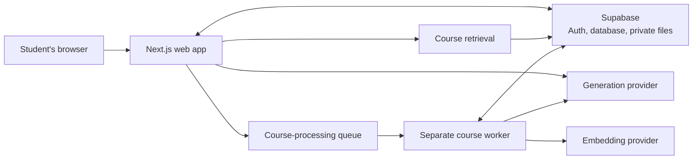

# Miva Buddy

Miva Buddy is a learning companion for Computer Science and Software Engineering students. I built it as an independent student project for Miva Open University students. It is not an official Miva University product.

I started building it around a familiar moment: you finish a lecture, but the idea still does not quite make sense. Your notes are in one place, a video in another, an AI chat somewhere else, and practice problems on a separate site. It can be hard to know what to study next, or how to get help without giving away the answer.

Miva Buddy brings course learning and DSA practice together, and makes room for career preparation without pretending to know more than its sources do.

## What it is like to use

### When you’re studying a course

Create a course, then add lecture notes or a PDF. Miva Buddy processes the material, finds concepts to explore, and keeps page references so you can see where a grounded answer came from.

You can also ask a general question in Learn. That conversation has no course material attached, so its answer is a general explanation—not a course-grounded one. Conversations are saved so you can come back to them. If your browser supports speech recognition, you can dictate into the Learn composer, review and edit the text, then send it yourself.

### When you’re practising DSA

Choose from 14 patterns and 107 curated problems. Open a problem in Miva Buddy, follow its link to the original LeetCode problem, and bring your own attempt or question back for coaching.

- **Hands Off** gives observations and reflective questions.
- **Coach** offers ideas and feedback, but not a complete answer.
- **Tutor** can walk through steps. It gives a complete answer only when you explicitly ask.

Miva Buddy does not see your LeetCode editor, submissions, or results. Completion is your own check-in; opening a problem does not mark it complete. Saved sessions and recent activity help you continue where you left off in the same browser.

### When you’re preparing for an interview

Ask about a company, role, or interview stage in the general Learn conversation. Miva Buddy can help with role-relevant topics, practice ideas, behavioral prompts, and a study plan based on what you told it.

It also offers external searches for Hacker News and LeetCode Discuss. These links open searches for you; Miva Buddy does not fetch or verify candidate accounts. The preparation is general guidance, not a description of that company’s interview process.

### When you’re connecting class to career preparation

Grounded Learn may show a few related job listings when the course material supports a concrete skill and an eligible metadata source is available. The cards show listing details and links, not verified employer requirements. Miva Buddy does not inspect job descriptions to prove a skill match, and the lesson still works when listings are unavailable.

## How the web app works

The browser talks to the Next.js app. The app handles student requests, saved data, course retrieval, and calls to the configured AI provider. Longer course processing runs separately in a worker, rather than inside the web request.



See [ARCHITECTURE.md](ARCHITECTURE.md) for the system boundaries and implementation details.

## Getting started

### You’ll need

- Node.js 20 or newer and npm.
- A Supabase development project (hosted or local) with anonymous sign-in enabled.
- For course-material processing: PostgreSQL, the separate worker, and an embedding provider. Ollama with `nomic-embed-text` is available for local embeddings; Gemini embeddings are also supported when explicitly selected.

Docker is not required for the hosted-development setup described below. The isolated local Supabase workflow uses Docker. Miva Buddy is not an offline-only app: Supabase provides authentication and saved data.

### Install and configure

Install the locked dependencies:

```sh
npm ci
```

Create an ignored `.env.local` file in the repository root. These two values are required for the web app:

```dotenv
NEXT_PUBLIC_SUPABASE_URL=<your-development-project-url>
NEXT_PUBLIC_SUPABASE_PUBLISHABLE_KEY=<your-development-publishable-key>
```

Apply reviewed SQL migrations in `drizzle/` to the intended development database in order, using its documented safe procedure. For the isolated local stack, use only the guarded command below. The [Supabase setup guide](docs/engineering/milestone-1-supabase-setup.md) and [deployment guide](docs/engineering/deployment-readiness.md) have more detail. Never commit `.env.local`, database URLs, or provider credentials.

For the isolated local Supabase workflow, start Docker Desktop and run `npx supabase start`, then apply the ordered migrations with `npm run db:migrate:local`. That command verifies the local Supabase/Docker identity and loopback database endpoint before invoking Drizzle; do not replace it with an unguarded migration command. Before uploading, confirm the private `course-materials` bucket exists in local Storage Studio: the repository config declares its limits, but that declaration did not provision the bucket in the observed local CLI setup. If missing, provision it through the local Supabase Storage UI, not by editing Storage's internal tables. The guarded `npm run dev:local-pdf-gemini` command starts the web app and worker together after rechecking local identity and queue state.

To queue and process course materials, also set a server-only `DATABASE_URL` and run the worker below. Ordinary local development defaults to fake AI and embeddings. For real model responses, choose a generation provider with `AI_PROVIDER` and configure its credentials—for example, `GEMINI_API_KEY` for Gemini—or use a reachable local Ollama service. For Ollama embeddings, set `EMBEDDING_PROVIDER=ollama`, `OLLAMA_BASE_URL`, and `OLLAMA_EMBEDDING_MODEL` (default: `nomic-embed-text`). The guarded `npm run dev:local-pdf-gemini` workflow verifies the local Supabase stack and queue, then starts the web app and worker with Gemini generation and embeddings. The recorded smoke test used synthetic content, but the launcher does not inspect or restrict uploaded content; it makes real Gemini API requests. See the [M3 setup record](docs/engineering/milestone-3-setup.md) before using it. The [provider decision](docs/engineering/ai-provider-decision.md) records evaluation and data-use caveats.

The `REMOTEOK_METADATA_PILOT=true` and `HIMALAYAS_METADATA_ENABLED=true` flags are optional. They are not needed to run Miva Buddy. Remote OK remains development-only, and neither job source verifies requirements from descriptions.

### Start the app

In one terminal, run:

```sh
npm run dev
```

Open [http://localhost:3000](http://localhost:3000). A new browser identity starts at onboarding; no email or password is required.

For course processing, start the worker in a second terminal:

```sh
npm run worker:dev
```

Without the worker, the app can still run, but new course materials will not finish processing.

## Built with

- Next.js App Router, React, TypeScript, and CSS.
- Supabase anonymous Auth, PostgreSQL, and private file storage.
- pg-boss for the course-processing queue.
- PostgreSQL full-text search and `pgvector` for course retrieval.
- Replaceable generation and embedding interfaces, with Gemini, Groq, and Ollama generation adapters and Gemini, Ollama, and deterministic fake embedding adapters.
- Zod for validation, Vitest for unit tests, and Playwright for browser tests.

## Repository map

```text
src/app/          Pages, server actions, and API routes
src/components/   Learn, Practice, course, and shared UI
src/contracts/    Validated request and response shapes
src/server/       Retrieval, AI, evidence, persistence, and worker logic
src/worker.ts     Separate course-processing worker
drizzle/          Database migrations
docs/             Product, architecture, engineering, and research docs
tests/            Unit, integration, and browser tests
```

## Development checks

```sh
npm run lint
npm run typecheck
npm test
npm run build
npm run test:e2e
npm run check:secrets
```

The default browser suite runs locally. Hosted Supabase tests are opt-in with `RUN_HOSTED_SUPABASE_TESTS=1`; they create anonymous test identities and synthetic records, so run them only with a safe test-data plan. Hosted end-to-end coverage is incomplete, including the latest interview-search and mobile journey. Local checks are not the same as hosted release acceptance.

Optional checks include `npm run test:embeddings:ollama` for a local synthetic embedding check and `npm run test:ai-evals` for synthetic prompts sent to the configured hosted AI provider. The dedicated local PDF/Gemini workflow is `npm run dev:local-pdf-gemini`; it requires a running local Supabase stack and a configured Gemini key, and makes provider requests. `npm run check:hosted-config` reports configuration status without printing values.

## Current limitations

- Miva Buddy is a development prototype. No public deployment has occurred; production hosting, services, backups, monitoring, and abuse protection remain release work.
- Job cards are related listings, not verified skill requirements. Interview links are external searches, not verified candidate accounts.
- Browser voice input depends on speech-recognition support and permissions. The browser vendor may process speech; Miva Buddy does not store raw audio. Typing remains available.
- Gemini embeddings and the synthetic PDF-to-grounded-Learn workflow have been verified on the isolated local Supabase stack. Migration 0010 has not been applied to or verified against either hosted Supabase project. Production hosting and a persistent worker runtime remain unverified; course-grounded Markdown still needs final visual regression testing.
- Recent hosted interview E2E coverage has not completed. See [project status](docs/plans/project-status.md) for the remaining gaps and release gates.

## Demo

**Demo video:** _Coming soon._

## Further reading

- [Architecture](ARCHITECTURE.md)
- [Current project status](docs/plans/project-status.md)
- [Local and production setup](docs/engineering/deployment-readiness.md)
- [Product and student workflows](docs/product/product-specification.md)
